  
  
  
  

## What I do

<table>
  <tr>
    <td width="25%" valign="top"><b>Systems &amp; IT</b> Servers, networks, security and the day-to-day tech that keeps teams running.</td>
    <td width="25%" valign="top"><b>Websites &amp; WordPress</b> Fast, secure websites built from scratch and kept healthy.</td>
    <td width="25%" valign="top"><b>SEO &amp; Digital Marketing</b> Getting found on Google and growing an audience online.</td>
    <td width="25%" valign="top"><b>EdTech</b> School platforms and the tools teachers and students use every day.</td>
  </tr>
</table>

## STARK AI

  

  A free, self-hosted <b>AI social media manager</b>. Talk to two assistants, <b>Vision</b> and <b>Wanda</b>, 
  and a team of seven specialist agents that write, check, schedule and publish your posts. 
  <b>Nothing goes out without your approval.</b> Runs on your own computer with free AI models.

<table align="center">
  <tr>
    <td align="center" width="25%"><b>Vision &amp; Wanda</b> talk by text or voice, English or Urdu</td>
    <td align="center" width="25%"><b>7 specialist agents</b> writer, researcher, red team, publisher and more</td>
    <td align="center" width="25%"><b>12 platforms</b> Bluesky, X, Threads, LinkedIn, Instagram, TikTok, YouTube…</td>
    <td align="center" width="25%"><b>Video studio</b> captions, Shorts and Reels, all on your computer</td>
  </tr>
</table>

  
  
  

  
  
  

  <a href="https://github.com/Shahrukhalid/stark-ai"><b>Source code</b></a> ·
  <a href="https://shahrukhalid.github.io/stark-ai/"><b>Website</b></a> ·
  <a href="https://github.com/Shahrukhalid/stark-ai/blob/main/docs/ASSISTANTS.md"><b>Meet the assistants</b></a> ·
  <a href="https://github.com/Shahrukhalid/stark-ai/issues"><b>Ideas and issues</b></a>

## Tools I work with

  

  Want to work together or have a question? Get in touch through <a href="https://shahrukhalid.com/contact/">shahrukhalid.com</a>.

