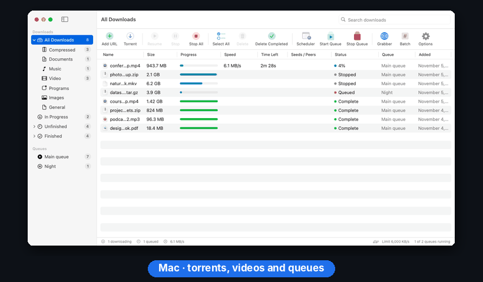

  

  I build <b>free, open-source software</b> for Mac, Windows, Linux and Android, with a focus on speed, privacy and reliability.

  
  
  

 

<h2 align="center">Nexonic Download Manager</h2>

  

  A free, open-source download manager for <b>Mac, Windows, Linux and Android</b>, built to be fast.

<table align="center">
  <tr>
    <td align="center" width="25%"><b>Up to 256 connections</b> per file, tuned automatically</td>
    <td align="center" width="25%"><b>Videos and torrents</b> 1,000+ sites and BitTorrent</td>
    <td align="center" width="25%"><b>Browser extensions</b> Chrome, Edge, Brave, Firefox</td>
    <td align="center" width="25%"><b>Keep in Sync</b> updates files that change</td>
  </tr>
</table>

  
  
  

 

<h2 align="center">Projects</h2>

<table>
  <tr>
    <td width="50%" valign="top">
      <h3><a href="https://github.com/Shahrukhalid/stark-ai">STARK AI</a></h3>
      Self-hosted AI social media manager that runs on free models. Every post waits for your approval.  
       <code>Python</code> <code>Next.js</code>
    </td>
    <td width="50%" valign="top">
      <h3><a href="https://github.com/Shahrukhalid/nexonic-iptv">Nexonic IPTV</a></h3>
      Free, verified playlists of legal live TV channels for VLC, Kodi and any IPTV app.  
       <code>Python</code> <code>GitHub Actions</code>
    </td>
  </tr>
  <tr>
    <td width="50%" valign="top">
      <h3><a href="https://github.com/Shahrukhalid/nexonic-tv-server">Nexonic TV Server</a></h3>
      Self-hosted IPTV player and Xtream Codes server with a TV guide, for Smart TVs and IPTV apps.  
       <code>FastAPI</code> <code>React</code>
    </td>
    <td width="50%" valign="top">
      <h3><a href="https://github.com/Shahrukhalid/Nexonic-Clear">Nexonic Clear</a></h3>
      See and remove image metadata and Content Credentials. Lossless and fully offline.  
       <code>Rust</code> <code>Tauri</code>
    </td>
  </tr>
  <tr>
    <td width="50%" valign="top">
      <h3><a href="https://github.com/Shahrukhalid/nexonic-sentinel">Nexonic Sentinel</a></h3>
      GitHub maintainer bot that triages issues and answers questions across these repositories.  
       <code>Python</code> <code>GitHub Actions</code>
    </td>
    <td width="50%" valign="top">
    </td>
  </tr>
</table>

 

<h2 align="center">Tech</h2>

  

 

  Questions, ideas and contributions are welcome. Open an issue or a discussion on any repository.

  

