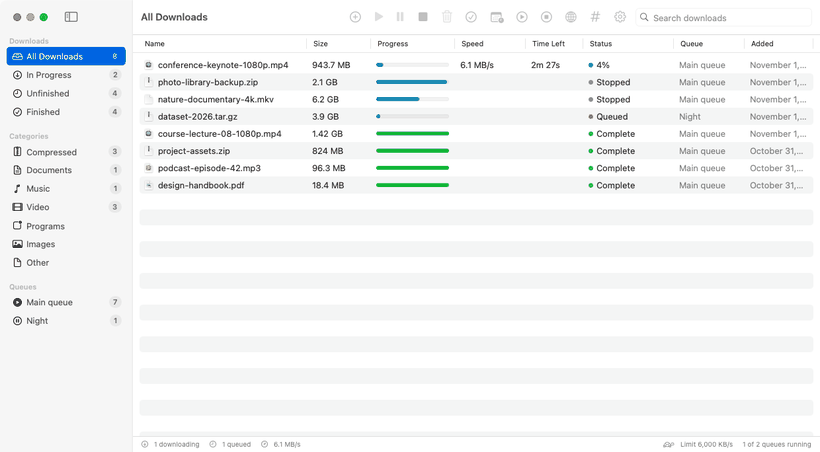

<h1 align="center">Hi, I'm Shahrukh Khalid 👋</h1>

  I build <b>free, open-source tools</b> people use every day: a download manager for Mac and Windows, live TV playlists, 
  and <b>multi-agent AI systems</b> that run on free models with safety and human approval built in. 
  Founder of <b>Nexonic Technologies</b> · Pakistan · open to work and collaborations.

  
  
  

---

## ⬇️ Nexonic Download Manager

  

A free, open-source **download manager for Mac and Windows**, an IDM alternative: up to 32 connections per file, pause and
resume, queues and a scheduler, a download window for every browser link, a live progress window, and videos from YouTube
and 1,000+ sites. Browser add-ons for Chrome, Edge, Brave and Firefox (signed by Mozilla), and updates inside the app.

  
  
  

`Swift` · `SwiftUI` · `C#` · `WPF` · `JavaScript (browser extension)` · `GitHub Actions`

---

## 📺 Nexonic IPTV

  

**Free M3U playlists of legal, officially free live TV**: one playlist with 4,300+ working channels from 159 countries,
also split by country, language and category. Every stream is checked automatically and channels that keep failing are
held back. Works in VLC, Kodi and any IPTV app.

  
  

Companion project: [**Nexonic IPTV v2**](https://github.com/Shahrukhalid/nexonic-iptv-v2), a self-hosted IPTV player and
Xtream Codes server with an EPG TV guide for Smart TVs.

---

## 🤖 AI and privacy projects

<table>
  <tr>
    <td width="50%" valign="top">
      
      <h3><a href="https://github.com/Shahrukhalid/stark-os">STARK OS</a></h3>
      A free, self-hosted <b>AI social media team</b>: 7 agents draft, fact-check and schedule posts for Bluesky, Mastodon and more. Nothing is published without your approval.  
      <code>Python</code> <code>FastAPI</code> <code>Next.js</code>
    </td>
    <td width="50%" valign="top">
      
      <h3><a href="https://github.com/Shahrukhalid/verilive">Verilive</a></h3>
      Is the face on your video call real? An <b>in-browser deepfake check</b> for Zoom, Meet and Teams using pulse, blink and face-swap signals. Video never leaves your device.  
      <code>TypeScript</code> <code>MediaPipe</code> <code>WebAssembly</code>
    </td>
  </tr>
  <tr>
    <td width="50%" valign="top">
      
      <h3><a href="https://github.com/Shahrukhalid/facevision-ai">FaceVision AI</a></h3>
      <b>Offline, consent-based</b> face detection, recognition and face blurring for macOS, Windows and Linux, with open ONNX models.  
      <code>Python</code> <code>FastAPI</code> <code>React</code>
    </td>
    <td width="50%" valign="top">
      
      <h3><a href="https://github.com/Shahrukhalid/nexonic-sentinel">Nexonic Sentinel</a></h3>
      A <b>GitHub maintainer bot</b> that looks after these repositories: triages issues, answers Discussions from the docs, welcomes contributors and merges safe dependency updates.  
      <code>Python</code> <code>GitHub Actions</code>
    </td>
  </tr>
</table>

---

## 📦 All projects

| Project | What it does | Status |
|---|---|---|
| [**Nexonic Download Manager**](https://github.com/Shahrukhalid/nexonic-download-manager) | Free download manager for Mac and Windows with browser add-ons and video downloads |  |
| [**Nexonic IPTV**](https://github.com/Shahrukhalid/nexonic-iptv) | Free, verified live TV playlists from 159 countries |  |
| [**Nexonic IPTV v2**](https://github.com/Shahrukhalid/nexonic-iptv-v2) | Self-hosted IPTV player and Xtream Codes server with EPG |  |
| [**STARK OS**](https://github.com/Shahrukhalid/stark-os) | Self-hosted multi-agent AI social media manager on free models |  |
| [**Verilive**](https://github.com/Shahrukhalid/verilive) | In-browser deepfake check for video calls |  |
| [**FaceVision AI**](https://github.com/Shahrukhalid/facevision-ai) | Offline face detection, recognition and blurring |  |
| [**Nexonic Sentinel**](https://github.com/Shahrukhalid/nexonic-sentinel) | GitHub App that maintains these repositories |  |
| [**MorphLive**](https://github.com/Shahrukhalid/morphlive) | Local camera and voice-effects research, contributors welcome |  |

---

## 🛠️ What I work with

  
  
  
  
  
  
  
  
  
  
  
  

**Focus areas:** desktop apps for Mac and Windows · multi-agent orchestration and tool calling · AI safety by design
(permissions, approvals, audit logs) · useful AI on free and open models · automated open-source maintenance.

---

## 🤝 Let's connect

  
  
  
  
  
  

Questions, ideas or contributions are welcome: open an issue or a discussion on any repository. New issues get a first
reply from [Nexonic Sentinel](https://github.com/Shahrukhalid/nexonic-sentinel), and I follow up myself.

⭐ If a project is useful to you, a star helps others find it.
